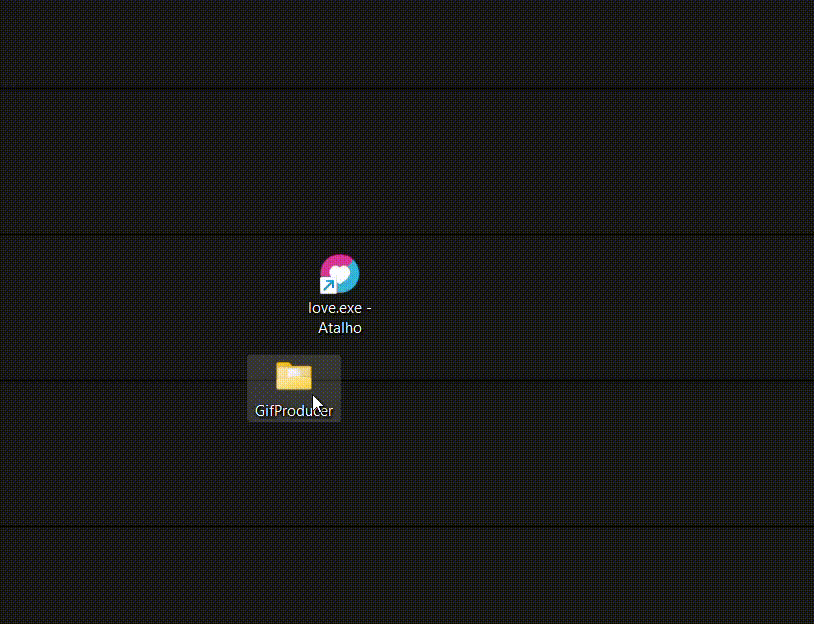
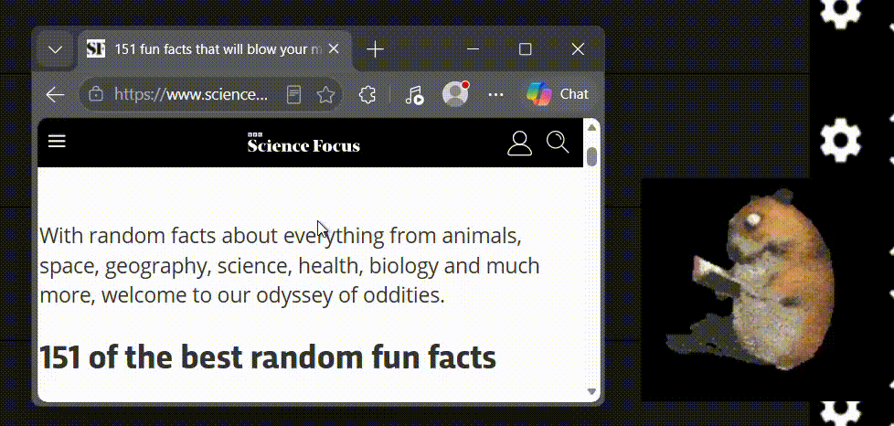

# Gif-Emulator 📷
## Breve Descrição 📃
O Gif-Emulator é exatamente o que o nome diz: faz nada mais do que somente reproduzir gifs. Esse programa é simplesmente uma forma mais divertida de criar janelas com GIFs e, invez de aparecer um monte de botões na tela, tudo é preparado pelo usuário antes para que nada te atrapalhe. Isso pode ser útil para aqueles que gostariam de reproduzir GIFs em sua área de trabalho, como para um vídeo do youtube, por exemplo.  
  
<figcaption><i>Figura 1: Usuário usando aplicativo pela primeira vez.</i></figcaption>

## Pré-requisitos 🔧
A única coisa que você precisará, além do próprio programa, é o aplicativo do Love2D, onde o programa acontece. Você pode instala-lo no seguinte link: https://love2d.org/

## Exemplo de uso 🧸
<figure>
   
  <figcaption><i>Figura 2: Um usuário lendo um texto junto com um hamster como companhia.</i></figcaption>
</figure>

## Como utilizá-lo 💻
### 1. Faça um spritesheet para o seu GIF
Um spritesheet é uma imagem só que contêm várias outras imagens. Esse conjunto de imagens podem ser usados para criar imagens animadas. Para fazer um, pode ser utilizado o seguinte site: https://spritesheetgenerator.online/. Para evitar erros, é recomendado que a imagem final seja um retângulo ou um quadrado perfeito.
### 2. Substitua o spritesheet que já está no programa pelo novo spritesheet.
Entre na pasta chamada "assets" e substitua a imagem com o nome "spritesheet.png" pela nova.
**⚠️ CUIDADO: O nome da nova imagem tem que ser EXATAMENTE como estava antes, se não o programa não conseguirá achar a imagem.**
### 3. Ajuste GridSize.txt
Na mesma pasta, abra "GridSize.txt" e insira a quantidade de imagens no eixo X na primeira linha e a quantidade de imagens no eixo Y na segunda linha. Após fazer isso, salve novamente o arquivo com o mesmo nome.
### 4. Abra o aplicativo
Agora tudo está pronto para o seu uso. Arraste a pasta principal (a que se chama Gif-Emulator) para o aplicativo do Love2D e o programa iniciará.
### 5. Controles
O programa contêm poucos controles, e eles são:  
● Mudar o tamanho da janela arrastando os cantos, como quase qualquer outra janela;  
● Pressione "B" para remover as bordas;  
● Mover a janela arrastando o canto superior

## Estrutura do projeto 🧩
### main.lua
Contém o código principal
### assets
Inclui o spritesheet do GIF e a quantidade de imagens em cada eixo.

## Licença ⚖️

MIT License

Copyright (c) 2026 bidux6

Permission is hereby granted, free of charge, to any person obtaining a copy
of this software and associated documentation files (the "Software"), to deal
in the Software without restriction, including without limitation the rights
to use, copy, modify, merge, publish, distribute, sublicense, and/or sell
copies of the Software, and to permit persons to whom the Software is
furnished to do so, subject to the following conditions:

The above copyright notice and this permission notice shall be included in all
copies or substantial portions of the Software.

THE SOFTWARE IS PROVIDED "AS IS", WITHOUT WARRANTY OF ANY KIND, EXPRESS OR
IMPLIED, INCLUDING BUT NOT LIMITED TO THE WARRANTIES OF MERCHANTABILITY,
FITNESS FOR A PARTICULAR PURPOSE AND NONINFRINGEMENT. IN NO EVENT SHALL THE
AUTHORS OR COPYRIGHT HOLDERS BE LIABLE FOR ANY CLAIM, DAMAGES OR OTHER
LIABILITY, WHETHER IN AN ACTION OF CONTRACT, TORT OR OTHERWISE, ARISING FROM,
OUT OF OR IN CONNECTION WITH THE SOFTWARE OR THE USE OR OTHER DEALINGS IN THE
SOFTWARE.
